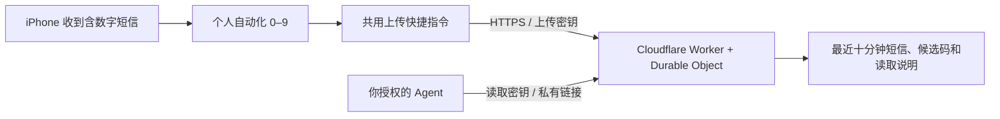

# iPhone SMS → Agent Inbox

把自己 iPhone 收到的含数字短信，自动上传到自己部署的私人接口。让具备联网能力的 AI Agent 读取最近十分钟的短信与验证码候选，不必反复手动复制。

开源的是代码与部署方法。每个人都部署自己的服务、生成自己的密钥；仓库不提供公共短信收件箱，也不包含作者的域名、账户、短信或密钥。



## 能实现什么

- 0–9 十条 iPhone 自动化，共用一个上传快捷指令；任意发件人的短信正文只要包含阿拉伯数字就触发。
- 接口保存原文，列出 1–8 位连续数字、字母或混合串，并根据上下文给出优先候选。
- 同一正文和发件人的重复上传会去重，不延长原来的展示期限。
- 十分钟后读取接口不再返回该短信，后台定时清理。
- 上传、读取使用不同的随机密钥；提供 JSON 接口和简单页面，JSON 自带 Agent 使用说明。
- 无生产依赖，不需要自己维护服务器。运行环境使用 Workers 和 Durable Objects；实际配额、费用以你的账户及官方当前政策为准。

## 先了解限制

**这是“含数字短信转发”，不是任意短信全收。** iOS 的“信息包含”条件不能直接用正则表达式；本项目实机验证时，发件人和正文筛选同时留空无法保存。纯字母验证码如果整条短信没有数字，不会触发。可以另外增加 `code`、`验证码` 等关键词规则，但不能把关键词当成严格识别。

短信正文、短英文单词、金额、订单号都可能出现在候选中，最终需要 Agent 根据当前登录平台和请求时间判断。十分钟只是**展示窗口**，不等于验证码本身有效十分钟。默认快捷指令只上传正文，展示窗口从服务器收到时开始；离线后延迟上传的内容也会从上传时起计时。接口可选 `received_at` 支持更准确的源时间。

Agent 必须能主动访问外部 HTTPS 地址。只会聊天、没有浏览器或请求工具的 Agent 不会因获得链接而自动具备联网能力。锁屏、网络、系统版本、首次权限和系统调度可能影响自动化，部署后务必用真实新短信测试。

## 让 AI 帮你部署

把这个仓库链接交给能执行命令、操作浏览器的 AI，然后发送下面这段话；完整执行约束在 [AI 部署指南](docs/AI-DEPLOY.md)。

> 请读取这个仓库的 README 和 docs/AI-DEPLOY.md，帮我部署一个属于我自己的 iPhone 短信收件箱。先确认我的 Cloudflare 账户和可用子域名，使用独立 Worker，不覆盖已有服务。用项目脚本生成独立的上传、读取密钥，部署后验证权限、去重和十分钟到期。为我生成私有上传快捷指令，指导或通过我授权的 iPhone 镜像配置 0–9 十条立即运行自动化，最后用一条真实新短信验证。不要在聊天、Git、截图或日志中输出密钥、私有读取链接或短信内容；只将接入说明写进本机 .private/agent-access.md。遇到登录、系统权限或缺少手机控制能力时，只暂停依赖我的步骤，不把配置完成冒充收信测试通过。

## 手动部署

准备 Node.js 22 或更新版本、Python 3、Cloudflare 账户，以及托管在该账户中的空闲子域名。Mac 可以生成并签名快捷指令；没有 Mac 时仍可按 [iPhone 配置](docs/IPHONE.md) 手工搭建相同操作。

1. 克隆本仓库并进入目录，运行 `npm test`。
2. 生成配置，把下面示例域名替换为你自己的真实子域名：

   ```sh
   npm run setup -- --domain otp.your-domain.com
   ```

3. 使用官方工具登录并部署：

   ```sh
   npx wrangler@4 login
   npm run deploy
   npm run verify
   ```

   也可由你自行在环境中配置 Cloudflare API Token；不要把它填入项目源码或聊天。首次 `npx` 会从 npm 下载官方 Wrangler 工具。自定义域名通过生成的配置绑定；如果域名已有服务，先换一个空闲子域名。不要删除或覆盖已有记录。

4. 生成快捷指令：

   ```sh
   npm run shortcut
   ```

   Mac 上将调用 Apple 自带的 `shortcuts sign --mode anyone`；签名可能需要联网和系统账户支持。生成文件在 `.private/`，导入你自己的“快捷指令”App，再同步或传给自己的 iPhone。签名不代表适合公开分享：文件包含你的上传密钥。Windows/Linux 会生成未签名文件，可转到 Mac 签名，或手工创建操作。

5. 按 [iPhone 配置](docs/IPHONE.md) 创建自动化，首次运行允许连接你自己的域名。让另一部手机发送测试短信，核对 `.private/agent-access.md` 中的 JSON 地址能读到它。
6. 把 `.private/agent-access.md` 中的接入内容私下交给你要授权的 Agent。不要上传这个文件或把私有链接贴进公开 Issue。

`npm run verify` 只上传合成测试内容，并验证它在接近十分钟的源时间到期后消失；不会发送真实短信，也不能代替第 5 步的手机测试。`npm run setup` 遇到已有配置会拒绝覆盖，以免意外更换现用密钥。更新现有安装直接运行 `npm run deploy`。

## 接口与运维

详见 [接口说明](docs/API.md) 和 [隐私及运维](SECURITY.md)。部署工具生成的 `.private/` 包含密钥和私有配置，已被 Git 忽略。版本库中只有通用示例配置。

核心代码在 `src/`，测试在 `test/`。复现过程总结在 [实现过程](docs/HOW-IT-WORKS.md)。

官方参考：[Workers 自定义域名](https://developers.cloudflare.com/workers/configuration/routing/custom-domains/)、[Workers Secrets](https://developers.cloudflare.com/workers/configuration/secrets/)、[Apple 信息触发条件](https://support.apple.com/guide/shortcuts/apdd711f9dff/ios)。

MIT License。
